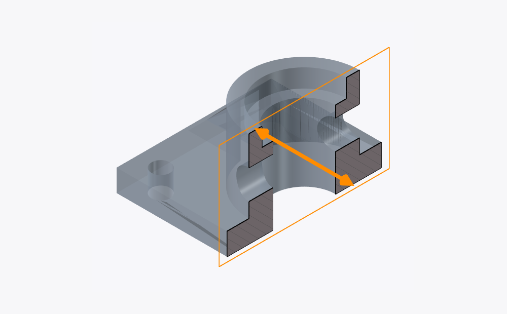
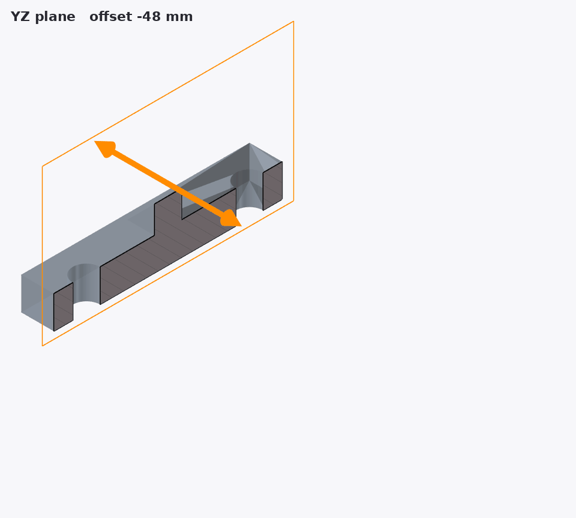
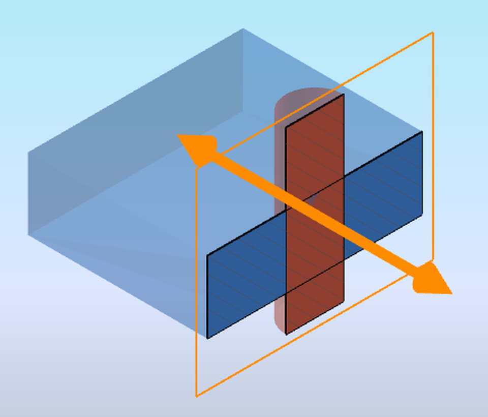
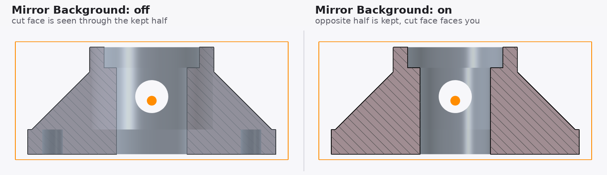
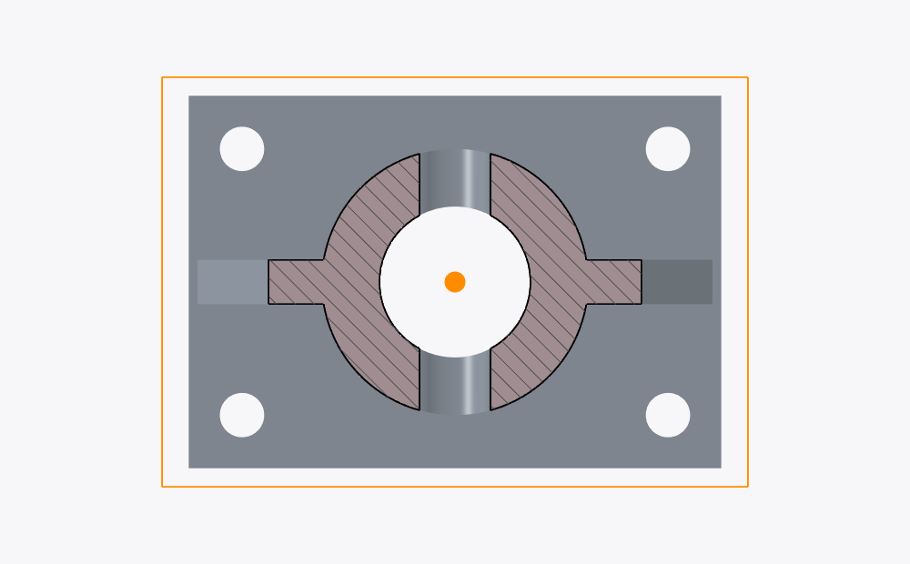

# FreeCAD LiveSectionAnalyzer

**Interactive, real-time section views for FreeCAD** – clip a solid with a plane, drag the plane with a 3D gizmo, and get a hatched cross-section that updates as you move.

[Türkçe](README.tr.md)

## Features

- **Live section** on the XY, XZ or YZ plane, moved with a slider, a spin box or **by dragging a gizmo** in the 3D view.
- **Multiple objects and assemblies** – pick the parts to section from a list; the plane clips everything you see, so you can check clearances between parts. Parts inside App::Part containers and links keep their assembly position.
- **Fast GPU clipping** (Coin3D `SoClipPlane`) – the model is not re-cut with a boolean on every move, so even complex parts stay responsive.
- **Section outline, fill and hatch** generated from the real cross-section (`Shape.slice`), with adjustable colors, line width, hatch spacing and point size.
- **Mirror Background** – keep the opposite half of the part. Only the clipping plane changes; the object never moves.
- **Freeze Section** – store the current view as normal, independent FreeCAD objects in a group.
- Background transparency, optional boolean-cut mode (when GPU clipping is off).

### Mirror Background

### Top view (XY)

## Installation

1. Download [`macro/LiveSectionAnalyzer.FCMacro`](macro/LiveSectionAnalyzer.FCMacro).
2. Copy it into your FreeCAD macro folder (**Macro → Macros…** shows the path; on Linux typically `~/.local/share/FreeCAD/Macro/`).
3. Run it from **Macro → Macros…**.

## Usage

1. Optionally select one or more solids (Part, Body, links, …) in the tree. Without a selection everything visible is clipped.
2. Run the macro. A dock panel opens.
3. Choose the plane (XY / XZ / YZ) and move it:
   - drag the orange arrow in the 3D view, or
   - use the slider / spin box.
4. Tune appearance in the panel (fill, edges, hatch, transparency).
5. Press **Freeze Section** to keep the result, **Close Analysis** to remove all temporary objects.

## Panel options

| Option | Meaning |
|---|---|
| Objects | Checked objects get the section fill/outline/hatch; everything visible is clipped. *Refresh* re-reads the visible solids |
| Show plane gizmo | Show/hide the draggable plane and arrow in the 3D view |
| Offset | Plane position; range follows the object size |
| Transparency | Transparency of the clipped background body |
| Fast GPU clipping | Clip on the GPU instead of a boolean cut |
| Mirror Background | Keep the opposite half of the part |
| Section Fill / Edge Lines / Hatch | Cross-section styling |
| Freeze Section | Copy the current section into a group of static objects |

## Tested with

- FreeCAD 1.1 and a 1.x/27.1 development build, Linux.
- Windows and macOS are untested; reports welcome.

## Limitations

- Objects that are not checked are clipped but get no section face (they look hollow).
- The section is a snapshot: if you move parts afterwards (e.g. an assembly solver), close and reopen the analysis.
- GPU clipping changes only the display; the real boolean cut is used for *Freeze* and when GPU clipping is off.
- Hatch lines are capped (`MAX_HATCH_LINES = 1500`) to keep very large sections fast; increase spacing instead of the cap if you see gaps.
- If the wrong half is clipped on your setup, flip `CLIP_KEEP_NEGATIVE` at the top of the macro.

## Documentation

- [Architecture notes](docs/ARCHITECTURE.md)
- [Changelog](CHANGELOG.md)
- [Contributing](CONTRIBUTING.md)

## License

MIT – see [LICENSE](LICENSE). © 2026 Sedat Kuran
